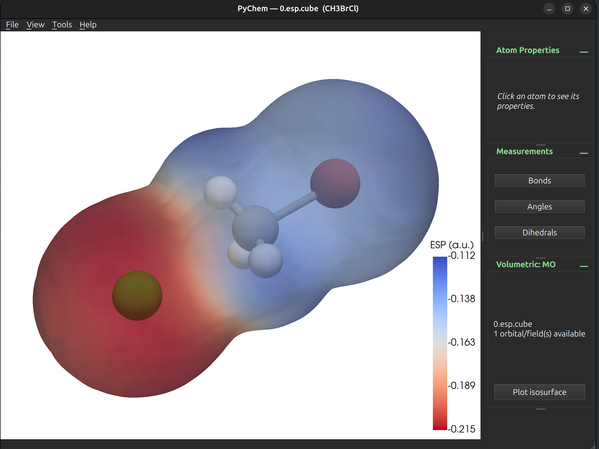

# PyChem

Pychem is a **modular** Python tool for molecular visualization and analysis, aiming to
grow into a Molden-like program. It currently allows to visualize structures and trajectories (xyz and pdb files), but also volumetric information (cube and molden files). It also has editing and measuring tools.



## Features

- Visualize .xyz and .pdb files containing either single structures or trajectories. 
- Select atoms to measure interatomic distances, angles and dihedrals.
- Edit structures and save them in a new file.
- *"Umbrella mode"* allows to select two atoms to create an axis and move other atoms around it, useful to generate first-guess structures of transition states.
- Visualize volumetric information, like orbitals or electrostatic potential maps.


## Layout

```text
pychem/
├── core/        # Scientific models (Atom, Molecule, bonds, elements)
├── io/          # File-format readers/writers + registry
├── rendering/   # Reusable PyVista viewer (molecules, ...)
├── app/         # PySide6 interface
└── analysis/    # (future) geometry, trajectories, volumes, NEB...
tests/
```

## Install

Requires **Python ≥ 3.12** and [uv](https://docs.astral.sh/uv/).

### Editable install (development, from the source checkout)

```bash
uv sync                  # create .venv and install the project (editable)
uv run pytest            # run the test suite
uv run pychem file.xyz   # run the command inside the project
```

### Global command (available from any directory)

```bash
uv tool install --editable .   # install the `pychem` command globally
pychem file.xyz                # now usable anywhere
```

(Use `uv tool install .` instead for a regular, non-editable global install;
re-run it after pulling changes.) To uninstall later: `uv tool uninstall pychem`.

## Usage

```bash
pychem                          # open the GUI empty; then File > Open structure... (Ctrl+O)
pychem file.xyz                 # open the GUI with a structure/trajectory/volume
pychem file.xyz --info          # text summary of the molecule
pychem file.xyz --screenshot out.png  # headless render to PNG and exit
```

For developers the same entry point can be run from the checkout without a
global install: `uv run python main.py [file]` or `uv run python -m pychem [file]`.
